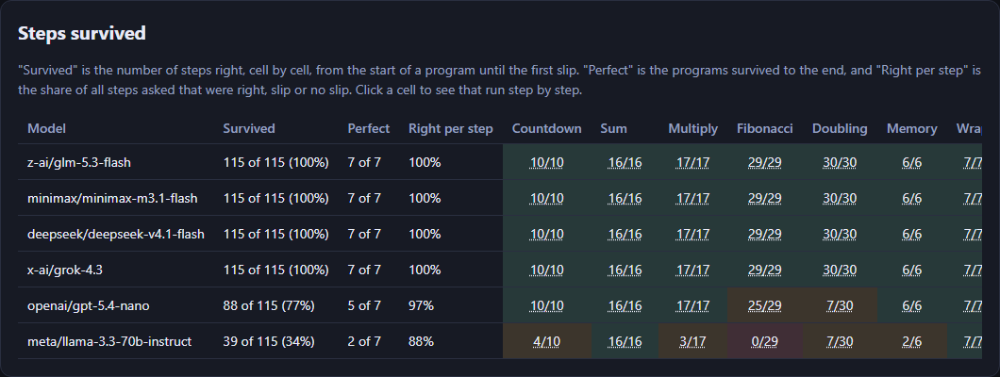
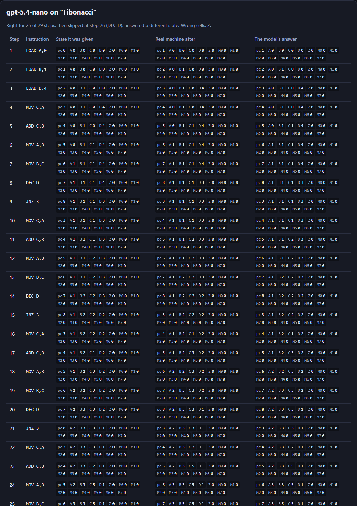
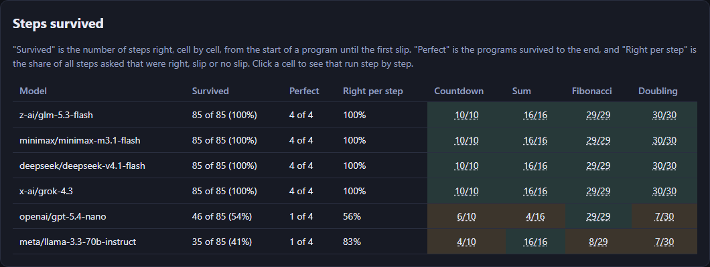

# Where It Slips

[](https://pollinations.ai/?ref=badge)

**Live:** https://tomdacatto.github.io/pollinations-where-it-slips/

Pollinations quest [#19179](https://github.com/pollinations/pollinations/issues/19179): an app where a model plays a machine, built on Pollinations models and paid with the visitor's own Pollen.

[WorldTUI](https://simedw.com/2026/10/21/world-model-terminal/) lets a small model imitate a terminal and [nesformer](https://github.com/dbreunig/nesformer) compiles an NES CPU into a model's weights. Both ask how faithful an imitated machine is. An imitation that looks right is easy to make, so this app keeps a **real machine next to the model** and checks every step.

## The machine

A toy computer in plain code ([`machine.js`](machine.js), no DOM, no network): four registers `A` to `D`, eight memory cells, a program counter `pc`, a zero flag `Z`, values 0 to 255 that wrap, and ten instructions (`LOAD`, `MOV`, `ADD`, `SUB`, `INC`, `DEC`, `LOADM`, `STORE`, `JNZ`, `HALT`). Seven short programs are offered: a countdown, a sum, a multiplication by repeated addition, four rounds of Fibonacci, a loop that doubles a register nine times and wraps past 255, a memory round trip and a wrap-around test (1 - 2 = 255, 255 + 255 = 254). The real run of all seven is 115 steps.

## The experiment

1. For each step the model gets one message ([`stepMessages`](machine.js), shown on the page): the rules, the full state as JSON and the instruction at `pc`. It must reply with the state after the instruction as JSON. Temperature 0, a different `seed` per request (identical requests are served from cache).
2. The real machine runs the same step and [`diff`](machine.js) compares every cell: `pc`, `A` to `D`, `Z` and `M0` to `M7`. All of them must match. A reply with no usable state, or a failed request, counts as a slip.
3. Two ways to feed the steps:
   - **Teacher forcing** (default): each step starts from the *true* state before it, so a mistake costs one step. This measures single-step accuracy and shows which kinds of step a model gets wrong.
   - **Free running**: the model's own answer is the state of the next step, and its own `pc` decides which instruction it is shown. One slip carries on into everything after it, as it would in a real run.
4. The page shows, per model and program, how many steps it **survived** (right from the start until the first slip), and for any run a step table with the state it was given, the real machine's answer and the model's answer with the wrong cells marked.

## A real run

Signed in with my own Pollen on the live code, six models that are free for every visitor, all seven programs, teacher forcing: 690 requests. The page's own estimate for that run is about 0.12 Pollen for the six models together (a rough figure from the listed prices).

| Model | Steps survived | Programs perfect | Right per step | Where it first slipped |
|---|---|---|---|---|
| glm-5.3-flash | 115 of 115 | 7 of 7 | 100% | never |
| minimax-m3.1-flash | 115 of 115 | 7 of 7 | 100% | never |
| deepseek-v4.1-flash | 115 of 115 | 7 of 7 | 100% | never |
| grok-4.3 | 115 of 115 | 7 of 7 | 100% | never |
| gpt-5.4-nano | 88 of 115 (77%) | 5 of 7 | 97% | Fibonacci step 26 (`DEC D`: wrong `Z`); Doubling step 8 (`JNZ`: wrong `pc`) |
| llama-3.3-70b-instruct | 39 of 115 (34%) | 2 of 7 | 88% | Countdown step 5 (`JNZ`: wrong `pc`); Fibonacci step 1 (reply not inspected) |



A model's own step table, with the cells it got wrong marked ([`docs/slip.png`](docs/slip.png)):



Free running, the same six models on four programs (countdown, sum, Fibonacci, doubling; 85 steps), one slip carries on:



What the runs show:

- **Four of six models never slipped** in either mode, on 115 steps each. This set of programs cannot rank them; it separates them from the two that do slip. A harder machine (more registers, longer programs, indirect addressing) would be the next step.
- **The slips are specific**: the ones seen were `JNZ` leaving the wrong `pc` (nano and llama, for example falling through when `Z` is 0 and the jump should be taken), the zero flag after `DEC`/`SUB` (nano, llama), and the doubling loop, where nano survived 7 of 30 steps in every run, each time at a `JNZ` (llama also 7 of 30). Those are what the step table is for.
- **Slips compound**: `gpt-5.4-nano` was right on 96% to 97% of steps when every step started from the true state and on 56% to 71% (two runs) when its own answers fed the next step (a slip in a loop sends `pc` somewhere else, and the rest of the run is a different program).
- **A model's score moves from run to run, even at temperature 0.** The same setup, run again: in teacher forcing `gpt-5.4-nano` survived 62 of 85 steps (first run, six programs), then 84 of 115 and 88 of 115, with Countdown at 2/10, 8/10 and 10/10 and Fibonacci at 14/29, 29/29 and 25/29; in free running 59 and 46 of 85. `llama-3.3-70b-instruct` survived 35 of 85, then 47 and 39 of 115 (35 of 85 in both free runs). The four top models were perfect every time. The page shows one run. Compare the gaps between models, not a single percentage.

## What the score means, and does not

- It is exact-match per step on a **toy machine**: a model with 100% here can still fail on a real instruction set, longer programs or a different prompt. It is not evidence that a model "contains" a CPU the way nesformer does; it shows how faithfully a general model plays one when told the rules in the prompt.
- Every step is a fresh call with the rules in the prompt. Nothing is learned between steps and no tool is used.
- A reply that is not a parsable state counts as a slip, whatever the reason, including a model that thinks aloud and never answers in JSON. The parser takes the last complete JSON object in the reply.
- The comparison is cell by cell, so a model that is right except for `Z` is wrong at that step. The zero-flag rule (set by `ADD`, `SUB`, `INC`, `DEC` only) is stated in the prompt, but it is the rule models trip on most.

## Not verified

- The sign-in redirect on the live address: the key was put into the page's session storage for the runs, not obtained through the sign-in on `tomdacatto.github.io`. `APP_KEY` in `config.js` is empty (no App Key was created), so the consent screen does not name the app yet.
- Browsers other than desktop Chrome and phones.
- Models other than the six defaults, and any paid model. Picking a paid-only model on free Pollen is meant to skip that model with a notice while the others carry on (a 402 on a model the list marks `paid_only`); that path has no unit test and was not run against a free-only account.
- Larger machines, other prompts, other temperatures, and runs repeated enough to put an error bar on a score.
- Cost: about 3,000 requests were made over all runs and probes, which is several full runs at the page's estimate (about 0.12 Pollen each); the balance was not read before and after, so there is no measured total. The key used for the runs answered 401 at the end, so no further runs were possible.
- `mistralai/mistral-large-3` was tried as a default and dropped: a request with a `seed` hung past 100 seconds in one of three tries.

## How it pays

There is no server and no key in this repository. The visitor signs in on enter.pollinations.ai ([Bring Your Own Pollen](https://github.com/pollinations/pollinations/blob/main/BRING_YOUR_OWN_POLLEN.md), fragment flow); the key comes back in the URL fragment, is removed from the address bar and is kept in `sessionStorage` for that tab only. The sign-in asks for a 0.5 Pollen budget and one day. If `APP_KEY` in `config.js` is set to a publishable `pk_` key, it is sent as `client_id` so the consent screen names the app. Models and prices come live from `gen.pollinations.ai/text/models`; the page shows a rough price before it runs. The default models are all free (`paid_only` false on `gen.pollinations.ai/v1/models`, checked 2026-11-12).

## Files

- `machine.js`: the real machine, the programs, the cell-by-cell diff, the step prompt and the reply parser (no network, no DOM)
- `trial.js`: one step asked and checked, teacher forcing, free running, and the scores
- `pollen.js`: sign-in and the chat call; `models.js`: the live model list
- `app.js`, `ui.js`, `index.html`, `style.css`: the page; `config.js`: budget, App Key, default models and programs

## Run and test

```bash
python -m http.server 8791   # any static server works
npm test                     # node --test, no dependencies: the machine, the diff, the parser, the scoring
```

MIT licensed.
